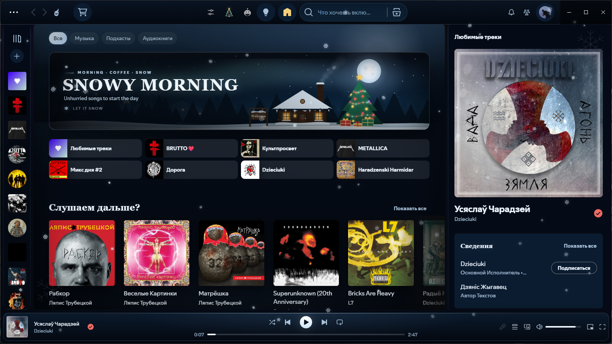

# Winter & Halloween for Spotify

A snowy winter and Christmas theme for [Spicetify](https://spicetify.app), with an optional Halloween mode.



## Features

- **Winter mode** — a storybook banner with a log cabin, chimney smoke, a fir forest, a distant town and a Welcome sign.
- **Decorated tree** — 39 small garland bulbs blinking every other bulb, 12 baubles and a glowing star.
- **Falling snow** and a small snow burst on every click.
- **40 daily banner greetings** — the text changes once per day.
- **Halloween mode** — the original haunted-house banner, cobwebs and a hanging spider.
- **Two languages** — Russian and English, switched from the gear button in the top bar and saved between restarts.
- **One-click seasons** — the tree button enables winter, the pumpkin enables Halloween. They are mutually exclusive.

## Install manually

1. Copy this folder to `%APPDATA%\spicetify\Themes\Winter & Halloween` (Windows) or `~/.config/spicetify/Themes/Winter & Halloween` (Linux/macOS).
2. Run:

```bash
spicetify config current_theme "Winter & Halloween"
spicetify config inject_theme_js 1
spicetify apply
```

## Settings

Click the **gear** button in the top bar and choose **Русский** or **English**. The choice is stored locally and applies to the banner, tooltips and settings.

## Notes

- Tested with Spotify 1.2.x and Spicetify 2.46.
- Large Spotify updates can reset Spicetify; run `spicetify apply` again if the theme disappears.
- The theme script is injected as an extension on Marketplace. For manual installs, keep `inject_theme_js = 1`.

## License

MIT — see [LICENSE](LICENSE).
